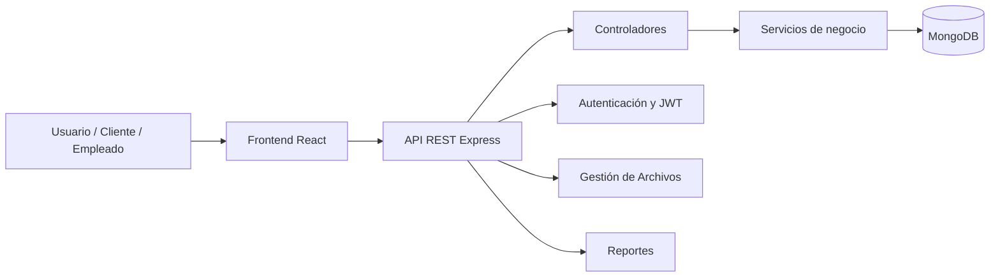

# Proyecto Final: Sistema de Gestión para Bar y Restaurante “La Tarima”

## 1. Descripción general

La Tarima es un sistema de gestión para un bar/restaurante que permite administrar reservas, mesas, productos, órdenes, pagos, descuentos, personal y reportes. La solución combina una API REST con una interfaz web para facilitar la operación del negocio en tiempo real.

El proyecto está basado en una arquitectura modular, pensada para soportar las operaciones diarias del negocio, con posibilidad de escalar a nuevas funcionalidades en etapas posteriores.

---

## 2. Objetivo del proyecto

Desarrollar una plataforma tecnológica para la gestión operativa del negocio, orientada a:

- controlar reservas y disponibilidad de mesas,
- gestionar clientes y personal,
- administrar el catálogo de productos,
- registrar órdenes y pagos,
- aplicar descuentos y promociones,
- generar reportes de operación,
- mejorar la experiencia del cliente y la eficiencia del personal.

---

## 3. Problema a resolver

Muchos establecimientos de servicio gastronómico presentan problemas como:

- reservas realizadas sin control real,
- falta de sincronización entre mesas y pedidos,
- dificultad para administrar pagos y descuentos,
- ausencia de reportes claros para la toma de decisiones,
- procesos manuales y propensos a errores.

La Tarima busca centralizar estas tareas en un sistema único, automatizado y ordenado.

---

## 4. Alcance funcional

### 4.1 Módulo de autenticación y seguridad
- inicio de sesión del personal,
- autenticación con JWT,
- control de roles,
- protección de rutas de administración.

### 4.2 Módulo de clientes
- registro de clientes,
- consulta de historial,
- identificación por documento,
- gestión básica de información.

### 4.3 Módulo de personal
- registro de meseros, administradores y cocina,
- asociación por roles,
- administración de información del empleado.

### 4.4 Módulo de mesas
- disponibilidad de mesas,
- estado: libre, ocupada, reservada, en limpieza,
- relación con reservas y órdenes.

### 4.5 Módulo de reservas
- creación de reservas,
- confirmación y cancelación,
- validación de horarios,
- relación con clientes y mesas.

### 4.6 Módulo de productos
- registro de productos y servicios,
- categorías,
- precios,
- imágenes,
- disponibilidad.

### 4.7 Módulo de órdenes
- creación de pedidos,
- asociar productos a una mesa o reserva,
- seguimiento del estado de preparación,
- notificaciones o estados de proceso.

### 4.8 Módulo de pagos
- registro de pagos por consumo,
- métodos de pago,
- control de transacciones,
- soporte para división de cuenta.

### 4.9 Módulo de descuentos
- cupones y promociones,
- descuentos por porcentaje o valor fijo,
- aplicación automática o manual.

### 4.10 Módulo de reportes
- ventas por día,
- productos más vendidos,
- mejores clientes,
- reportes financieros y operativos.

---

## 5. Usuarios del sistema

### Administrador
- gestiona personal,
- configura productos y promociones,
- revisa reportes,
- controla el estado general del negocio.

### Mesero
- registra reservas,
- atiende mesas,
- crea órdenes,
- realiza cobros básicos.

### Cocina
- recibe pedidos,
- cambia estado de preparación,
- confirma entrega.

### Cliente
- reserva una mesa,
- consulta disponibilidad,
- realiza pagos o solicita atención.

---

## 6. Arquitectura propuesta

La solución se diseña con una arquitectura de tres capas:

### 6.1 Capa de presentación
- Frontend web en React + Vite,
- pantallas para login, reservas, productos, pagos, reportes,
- experiencia de usuario amigable y operativa.

### 6.2 Capa de negocio
- servicios y controladores de Express,
- validaciones de reglas del negocio,
- lógica de reservas, pedidos, pagos y descuentos.

### 6.3 Capa de datos
- MongoDB como base de datos principal,
- modelos Mongoose para cada entidad,
- almacenamiento de clientes, productos, mesas, pagos y reportes.

---

## 7. Stack tecnológico

### Frontend
- React
- Vite
- JavaScript
- CSS / estilos personalizados

### Backend
- Node.js
- Express.js
- Mongoose
- JWT
- multer
- express-validator
- dotenv

### Base de datos
- MongoDB

### Complementos
- Mailer para notificaciones
- manejo de archivos de imagen para productos
- validación de datos y manejo centralizado de errores

---

## 8. Modelo de datos principal

El sistema se compone de entidades clave:

### Cliente
- docID
- fullname
- email
- phone
- status

### Staff
- user_id
- fullname
- role
- email
- password

### Mesa
- table_id
- number
- capacity
- currentStatus
- zone

### Reserva
- reservation_id
- table_id
- clientRef
- guest
- startTime
- endTime
- status

### Producto
- product_id
- name
- category
- basePrice
- stock
- image

### Orden
- order_id
- reservation_id
- table_id
- items
- status
- total

### Pago
- payment_id
- order_id
- reservation_id
- amount
- method
- status

### Descuento
- discount_id
- code
- type
- value
- validUntil

---

## 9. Diagrama general del sistema

---

## 10. Flujo principal de negocio

### Caso 1: Reserva de mesa
1. El cliente o mesero ingresa la fecha, hora y cantidad de personas.
2. El sistema valida la disponibilidad de la mesa.
3. Se crea la reserva con estado pendiente o confirmada.
4. La mesa cambia a estado reservado.
5. Cuando el cliente llega, se activa la reserva y se asigna la mesa.

### Caso 2: Crear una orden
1. El mesero selecciona la mesa o reserva.
2. Agrega productos al pedido.
3. El sistema calcula el valor total.
4. La orden pasa por estados de preparación.
5. Cocina actualiza el progreso.

### Caso 3: Pago
1. El sistema obtiene el total de la orden o reserva.
2. Se aplica descuento si aplica.
3. Se registra el método de pago.
4. Se actualiza el estado del pago.
5. La mesa queda disponible.

---

## 11. Reglas de negocio clave

- una mesa no puede estar reservada y ocupada al mismo tiempo,
- una reserva debe tener un cliente o un invitado registrado,
- un pedido debe estar asociado a una mesa o reserva,
- los descuentos solo se aplican si están vigentes,
- el pago debe validarse antes de cerrar la cuenta,
- el estado de la mesa debe reflejar el flujo real del negocio.

---

## 12. Beneficios del sistema

- reduce errores operativos,
- mejora la trazabilidad de las ventas,
- permite tomar decisiones con datos reales,
- agiliza atención al cliente,
- facilita control del negocio en tiempo real,
- genera una base tecnológica sólida para escalar o abrir más sucursales.

---

## 13. Retos y mejoras futuras

- implementar autenticación y autorización más robusta,
- mejorar validaciones y consistencia entre modelos,
- agregar notificaciones push o email,
- crear panel de analytics más avanzado,
- integrar pagos digitales reales,
- migrar a microservicios o modularización más profunda.

---

## 14. Conclusión

La Tarima se convierte en un proyecto final de arquitectura de software viable y valioso, porque no solo implementa funcionalidades, sino que demuestra la capacidad de diseñar un sistema con flujo real de negocio, estructura modular, control de datos y lógica operativa aplicada a un caso de uso realista.

Es una propuesta sólida para una sustentación final, especialmente si se presenta como un sistema de gestión de bar/restaurante con criterios arquitectónicos claros, reglas de negocio, módulos funcionales y una base tecnológica bien definida.

---

## 15. Siguiente paso recomendado

Para llevar este proyecto al siguiente nivel, se recomienda:

1. completar la autenticación con JWT,
2. corregir inconsistencias de modelos,
3. normalizar nombres de campos,
4. documentar el diagrama de componentes,
5. preparar una presentación con arquitectura, flujo y módulos.

Con esto, el proyecto queda listo para ser presentado como proyecto final de arquitectura de software.
